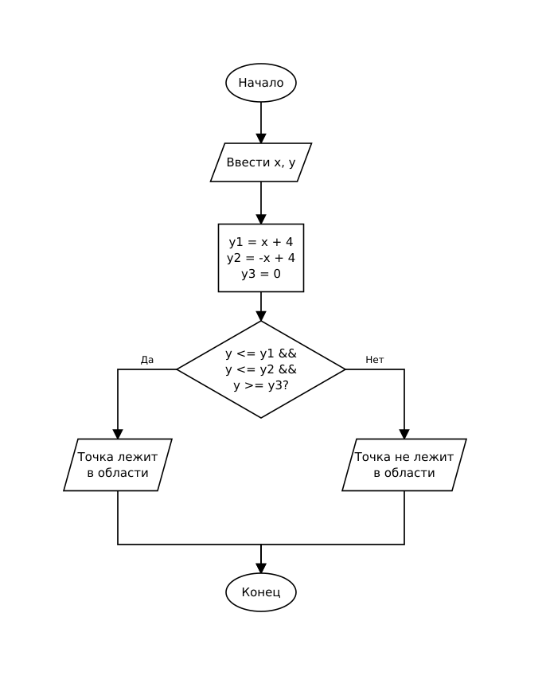

# Домашнее задание к работе 6

## Условие задачи (Вариант 2)

Определить, попадает ли точка с заданными координатами (x, y) в заштрихованную область на плоскости.

Область представляет собой треугольник, ограниченный следующими прямыми:
- y1 = x + 4
- y2 = -x + 4
- y3 = 0

Пользователь вводит с клавиатуры вещественные координаты точки x и y. Программа выводит псевдографическое изображение области и сообщает, лежит ли точка в заданной области.

---

## 1. Алгоритм и блок-схема

### Алгоритм

1. Настроить русскую локализацию для корректного вывода сообщений.
2. Запросить у пользователя и ввести вещественные координаты точки: `x` и `y`.
3. Вывести псевдографическое изображение треугольной области.
4. Вычислить уравнения граничных прямых:
   - `y1 = x + 4`
   - `y2 = -x + 4`
   - `y3 = 0`
5. Проверить условие попадания точки в область: `y <= y1 && y <= y2 && y >= y3`.
6. Если условие истинно, вывести сообщение о том, что точка лежит в заданной области.
7. Если условие ложно, вывести сообщение о том, что точка не лежит в заданной области.
8. Завершить работу программы.

### Блок-схема



---

## 2. Реализация программы

Исходный код программы: [Source.c](Source.c)

---

## 3. Результаты работы программы

Пример 1 — точка внутри области (x = 0, y = 2):

```
Введите x,y:
0
2
        \        
       /|\       
      /.|.\      
     /..|..\     
   //...|...\\   
  /.....|.....\  
 /......|......\ 
/-------+-------\
        |        
Точка (0.00, 2.00) лежит в заданной области
```

Пример 2 — точка вне области (x = 2, y = 3):

```
Введите x,y:
2
3
        \        
       /|\       
      /.|.\      
     /..|..\     
   //...|...\\   
  /.....|.....\  
 /......|......\ 
/-------+-------\
        |        
Точка  (2.00, 3.00) не лежит в заданной области
```

---

## 4. Информация о разработчике

- **ФИО:** Аносов Сергей Юрьевич
- **Группа:** бОТИ-261
